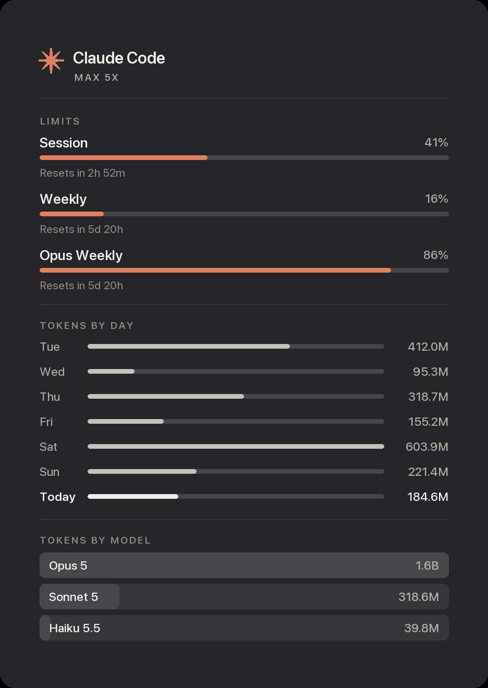

# Claude usage widget

A macOS menu bar panel showing what you are spending on Claude Code — tokens by
day, by model and by project, plus the live 5-hour block timer and burn rate.

<p align="center">
  
</p>

<sub>Screenshot uses synthetic data.</sub>

## What it gives you that `/usage` doesn't

`/usage` inside Claude Code is the authoritative source for your **plan quota**.
This widget does not replace it — it covers what `/usage` leaves out:

|                               | `/usage` | this widget |
| ----------------------------- | :------: | :---------: |
| Real plan quota               |    ✅    | estimated\* |
| Visible without opening Claude|    ❌    |     ✅      |
| Per-day history               |  limited |   7 days    |
| Per-project spend             |    ❌    |     ✅      |
| Cost in dollars               |    ❌    |     ✅      |
| Live burn rate                |    ❌    |     ✅      |

\* See **Real limits** below. Costs are API-equivalent pricing computed from
local logs; on a subscription plan you are not billed these amounts.

## Requirements

- macOS
- [SwiftBar](https://github.com/swiftbar/SwiftBar) — `brew install --cask swiftbar`
- [ccusage](https://github.com/ryoppippi/ccusage) — `npm install -g ccusage`
- Python 3 with [Pillow](https://pypi.org/project/Pillow/) — `python3 -m pip install Pillow`

## Install

```bash
git clone https://github.com/joemar-tagpuno/claude-usage-widget.git
cd claude-usage-widget
./install.sh
```

The installer checks dependencies, copies files to `~/.claude/usage-widget`,
installs the SwiftBar plugin and runs a first collection. It does not modify any
Claude Code settings.

## Real limits

Anthropic publishes no quota API, and Claude Code caches nothing locally that is
current. So the `LIMITS` bars start as **estimates against your own 4-week norm**,
and the panel says so in its footer.

To make them real, run `/usage` in Claude Code and feed the percentages back:

```bash
python3 ~/.claude/usage-widget/calibrate.py --session 7 --weekly 7
```

Your current token counts divided by those percentages recover the underlying
budgets, which are written to `config.json`; the footer caveat then disappears.
Re-run after changing plan.

## Configuration

`~/.claude/usage-widget/config.json`:

| Key           | Default | Meaning                                              |
| ------------- | ------- | ---------------------------------------------------- |
| `plan_label`  | `""`    | Shown under the title, e.g. `MAX 5X`                  |
| `theme`       | `auto`  | `auto` follows the system; or `dark` / `light`        |
| `panel_width` | `326`   | Image width in points (260–900)                       |
| `left_inset`  | `15`    | Left padding offsetting macOS's wider right inset     |
| `padding`     | `3`     | Internal side padding (0–40)                          |
| `budgets`     | `null`  | Set by `calibrate.py`                                 |

### Menu bar label

What sits beside the asterisk is a comment-toggled constant near the top of
`plugins/claude-usage.1m.py` — uncomment exactly one:

```python
MENUBAR = "timer"        # 2h37    time left in the 5-hour block (default)
# MENUBAR = "icon"       #         asterisk only, no text
# MENUBAR = "percent"    # 47%     session % of limit
# MENUBAR = "weekly"     # 4%      weekly % of limit
# MENUBAR = "tokens"     # 184M    tokens used today
# MENUBAR = "cost"       # $49.46  today's API-equivalent spend
# MENUBAR = "cost_timer" # $49.46 - 2h37
```

`percent` and `weekly` are estimates until you run `calibrate.py`. `cost` and
`cost_timer` show API-equivalent pricing, which is **not** what a subscription
plan bills you — a dollar figure in the menu bar is the least meaningful number
available to a subscriber, which is why the timer is the default.

### Width and margins

Two helpers apply a change and refresh SwiftBar immediately:

```bash
./set-width.sh 400    # panel width
./set-inset.sh 12     # left/right margin balance
```

## How it works

`ccusage` takes ~6s per invocation, far too slow to run on every menu render. So:

- **`collect.py`** runs ccusage and writes `cache.json`. `--fast` refreshes the
  active block (~5s); `--full` also refreshes daily history and projects (~17s).
- **`panel.py`** renders the panel to a PNG — SF Pro via its variable weight axis,
  drawn at 2× and tagged 144 DPI so macOS displays it crisply at half size, on a
  transparent background so it sits in the menu as native content.
- **The plugin** reads `cache.json` instantly (~0.1s) and spawns a *detached*
  background refresh only when it is stale — block after 2 minutes, history
  after 15. A lock file prevents concurrent refreshes from stampeding ccusage.

Project names are recovered from ccusage's dash-encoded paths by walking the
filesystem, so directories containing hyphens resolve correctly.

## Notes

**Menu width.** macOS reserves chrome around an image menu item, and a submenu
anywhere in a menu reserves an arrow column across every row. The plugin therefore
sets `swiftbar.hide*` metadata to suppress SwiftBar's appended rows, which keeps
the menu tight. The remaining asymmetry is balanced with `left_inset`.

**SwiftBar 2.1.1 quirk.** It recreates an empty mirror of the plugin's own
absolute path inside the plugin folder on each launch. The plugin deletes it on
its next run, but only after verifying it contains no files.

**Privacy.** Everything runs locally. `cache.json` and `config.json` hold your
usage data and are git-ignored.

## License

MIT
